# SDLC Master Pipeline (diagram)

**Một chủ đề:** SDLC Master Pipeline — thứ tự 17 bước `S1…S17`, 16 cổng `G1…G16` cùng 3 trạm kiểm soát định lượng (**Cross-checks**, **Pre-flight DoR**, **Go / No-Go**) của pipeline chính. Phân định rạch ròi 4 vai trò (**BA · TECH · QC · PM/PO**) cùng thư mục lưu trữ artifact tương ứng trong `sdlc/`. Không mô tả CR pipeline (xem [`02.cr-pipeline`](02.cr-pipeline.md)).

> **Rule:** [`10.main-pipeline-rule`](../01.standard/10.main-pipeline-rule.md). Upstream zoom `S1…S7`: [`03.intent-pipeline`](03.intent-pipeline.md).

## 1. Mermaid — **nguồn sự thật**

```mermaid
%%{init: {"flowchart": {"wrappingWidth": 460, "nodeSpacing": 45, "rankSpacing": 65, "htmlLabels": true}}}%%
flowchart TD
    subgraph A["A · KHỞI TẠO & YÊU CẦU (PO & BA)"]
        S1["S1 · Pain point & Vision (PO)<br/>vấn đề thực tế · ai đau · bối cảnh<br/><i>sdlc/03.inception/00.problem/</i>"]
        S2["S2 · Goals & Objectives (PO; PM consult)<br/>mục tiêu (nhiều quý) · objectives + metrics (sprint)<br/><i>sdlc/03.inception/01.vision/</i>"]
        S3["S3 · BRD & Business Rules (BA)<br/>luật bất biến · use cases · actor rights<br/><i>sdlc/05.requirements/01.specification/02.brd/</i>"]
        S4["S4 · PRD & Feature Scope (PO)<br/>F-01…F-nn · in/out scope · release metric<br/><i>sdlc/05.requirements/01.specification/01.prd/</i>"]
        S5["S5 · FRD (Input/Output/Error) (BA)<br/>1 file/năng lực: vào · ra · từ chối · mã lỗi<br/><i>sdlc/05.requirements/01.specification/03.frd/</i>"]
        S6["S6 · SRS & System REQ (BA)<br/>REQ-01…REQ-nn · ràng buộc kỹ thuật · giao diện ngoài<br/><i>sdlc/05.requirements/01.specification/04.srs/</i>"]
        S7["S7 · User Stories & AC (BA)<br/>story giá trị · tiêu chí nghiệm thu kiểm được<br/><i>sdlc/06.analysis/01.us/ & 02.ac/</i>"]
    end

    subgraph CHK1["TRẠM KIỂM ĐỊNH YÊU CẦU (QC & PM)"]
        GATE_REQ{"Cross-checks X1, X2, X4–X7, X16–X20<br/>Traceability REQ ↔ AC · Link toàn vẹn · Không mồ côi"}
    end

    subgraph B["B · THIẾT KẾ KỸ THUẬT (TECH)"]
        S8["S8 · Interface & API Contracts (TECH)<br/>endpoint · in/out · idempotency · mã lỗi · zero-turn-path D-46<br/><i>sdlc/07.technical/03.api/</i>"]
        S9["S9 · Data Design & Schema (TECH)<br/>entities · schema · persistence · DuckDB queries/slices<br/><i>sdlc/07.technical/02.data-design/</i>"]
        S10["S10 · Architecture C4 & NFR (TECH)<br/>C4 L1–L3 · Super Combo topologies · NFR specs<br/><i>sdlc/07.technical/01.architecture/</i>"]
    end

    subgraph C["C · PHÂN RÃ & SẴN SÀNG THI CÔNG (PM, TECH, QC)"]
        S11["S11 · WBS Work Packages (PM)<br/>deliverable → epic → story → leaf (slice)<br/><i>sdlc/12.phases/*/02.wbs/</i>"]
        S12["S12 · BIP / FIP Packets (TECH)<br/>1 packet/leaf · BIP=backend · FIP=frontend · khóa allowed_files<br/><i>sdlc/12.phases/*/02.wbs/</i>"]
        S13["S13 · Scenario Matrix SCN (QC)<br/>mỗi AC có ≥1 SCN: happy · edge · failure · rbac · tenant<br/><i>sdlc/06.analysis/03.scn/ & 04.rtm/</i>"]
    end

    subgraph CHK3["TRẠM DUYỆT SẴN SÀNG THI CÔNG (DoR GATE TỪNG SLICE)"]
        GATE_DOR{"Pre-flight Readiness Checklist (PM & QC)<br/>X3: 1:1 AC ↔ SCN · Đủ 8/8 dòng pre-code (Stage 0–7)<br/>BIP/FIP READY · Test file khai rõ"}
    end

    subgraph CHK2["TRẠM DUYỆT KHẢ THI & KẾ HOẠCH (CẤP INCREMENT)"]
        GATE_GONOGO{"Go / No-Go Dashboard (PM & QC)<br/>Docs Ready: REQ ∩ AC ∩ SCN ∩ IF ∩ DATA + BIP/FIP<br/>Pass: X8, X8a, X9, X10, X21, X22, X34–X36"}
    end

    subgraph D["D · THỰC THI & CHỨNG MINH (DEV, QC, PM, PO)"]
        S14["S14 · Code Implementation (DEV)<br/>TDD quartet: tdd-unit RED → tdd-impl GREEN → tdd-coverage ≥80%<br/>+ tdd-load/stress cho runtime slice · không code ngoài packet"]
        S15["S15 · Run SCN Scenarios & Trace (QC)<br/>chạy scenario + ghi evidence.json + cập nhật RTM status<br/><i>sdlc/10.test/ & 12.phases/*/06.acceptance/</i>"]
        S16["S16 · DoD Verification (QC & PM)<br/>DoD D-116 · E2E report · 0 CRITICAL · smoke screenshot"]
        S17["S17 · Done — NGƯỜI KÝ (PO & PM)<br/>PO & PM ký nghiệm thu · máy KHÔNG được ký Done — BR-05<br/><i>sdlc/12.phases/*/07.closure/</i>"]
    end

    S1 -->|"G1 · pain trace vision"| S2
    S2 -->|"G2 · goal & objective có metric (X17)"| S3
    S3 -->|"G3 · mọi BR/UC trace Goal/Pain"| S4
    S4 -->|"G4 · mọi F trace P + G + O"| S5
    S5 -->|"G5 · F đủ 6 mục + ≥1 từ chối"| S6
    S6 -->|"G6 · REQ trace F + BR"| S7
    S7 --> GATE_REQ
    GATE_REQ -->|"G7 · PASS X-checks"| S8
    S8 -->|"G8 · contract khớp FRD/SRS"| S9
    S9 -->|"G9 · schema zero-drift"| S10
    S10 -->|"G10 · plane kỹ thuật sẵn sàng"| S11
    S11 -->|"G11 · leaf có AC + owner + size"| S12
    S12 -->|"G12 · packet cite được arch & data"| S13
    S7 -.->|"Map tiêu chí AC sang test"| S13
    S13 --> GATE_DOR
    GATE_DOR -->|"G13 · DoR PASS từng slice"| GATE_GONOGO
    GATE_GONOGO -->|"G13b · GO: Docs Ready toàn increment"| S14
    S14 -->|"G14 · code xanh trong allowed_files"| S15
    S15 -->|"G15 · 100% SCN xanh · RTM đủ"| S16
    S16 -->|"G16 · đủ 4 điều kiện thoát DoD D-116"| S17

    %% Vòng lặp phản hồi / Change Request (CR)
    GATE_REQ -.->|"CR · REQ/AC thiếu hoặc mồ côi"| S5
    GATE_DOR -.->|"CR · packet chưa READY / thiếu SCN"| S12
    GATE_GONOGO -.->|"NO-GO · thiếu interface/schema/packet"| S8
    S15 -.->|"CR · SCN đỏ (lỗi triển khai)"| S14
    S16 -.->|"CR · DoD không đạt (thiếu test/evidence)"| S14

    classDef req fill:#EAF1F8,stroke:#1F4E79,stroke-width:2px,color:#111111
    classDef tech fill:#F2F2F2,stroke:#333333,stroke-width:2px,color:#111111
    classDef ready fill:#E6F4F1,stroke:#0F7B6C,stroke-width:2px,color:#111111
    classDef exec fill:#FDF0E6,stroke:#C55A11,stroke-width:2px,color:#111111
    classDef gate fill:#FFF2CC,stroke:#D6B656,stroke-width:2px,color:#111111

    class S1,S2,S3,S4,S5,S6,S7 req
    class S8,S9,S10 tech
    class S11,S12,S13 ready
    class S14,S15,S16,S17 exec
    class GATE_REQ,GATE_DOR,GATE_GONOGO gate
```

## 2. Ảnh sinh ra

> **Ảnh là artifact sinh ra từ Mermaid ở §1** — không sửa tay. Regenerate:
> `npx -y @mermaid-js/mermaid-cli -p /tmp/pptr.json -i sdlc/02.governance/04.diagrams/01.main-pipeline.md -o /tmp/out.png -s 2 -b white`
> `(cp /tmp/out-1.png sdlc/02.governance/04.diagrams/01.main-pipeline.png && cp /tmp/out-1.png eso/ui/public/diagrams/01.main-pipeline.png)`

## 3. Phân định vai trò & Artifact lưu trữ (RACI & Folders chuẩn)

| Nhóm giai đoạn | Bước | Vai trò chủ trì | Loại tài liệu xuất bản (`kind:`) | Thư mục lưu trữ chuẩn trong `sdlc/` | Checkpoint / Gate kiểm soát |
|---|---|---|---|---|---|
| **A · Yêu cầu & Mục tiêu** | **S1** Pain / Vision | **PO** | `concept`, `charter` | `03.inception/00.problem/` · `12.phases/*/` | `G1`: Pain trace Vision |
| | **S2** Goals & Objectives | **PO (PM consult)** | `concept`, `business-case` | `03.inception/01.vision/` | `G2`: Goal + Objective có metric đo được (`X17`) |
| | **S3** BRD | **BA** | `brd`, `actor-catalog`, `business-rule` | `05.requirements/01.specification/02.brd/` | `G3`: BR trace Goal & Pain |
| | **S4** PRD | **PO** | `prd`, `feature-catalog` | `05.requirements/01.specification/01.prd/` | `G4`: Mọi F trace Objective |
| | **S5** FRD | **BA** | `frd` (vào, ra, từ chối, mã lỗi) | `05.requirements/01.specification/03.frd/` | `G5`: Đủ 6 mục FRD + mã lỗi |
| | **S6** SRS | **BA** | `srs`, `requirement` (REQ-*) | `05.requirements/01.specification/04.srs/` | `G6`: REQ trace F + BR |
| | **S7** US / AC | **BA** | `user-story`, `acceptance-criteria` | `06.analysis/01.us/` `06.analysis/02.ac/` | `G7`: 100% REQ có AC kiểm được |
| **Kiểm định yêu cầu** | **CHK1** | **QC & PM** | Báo cáo rà soát | `02.governance/02.records/01.document-status.md` | **Cross-checks X1, X2, X4–X7, X16–X20** |
| **B · Thiết kế kỹ thuật** | **S8** Interface & API | **TECH** | `api-contract`, error catalog | `07.technical/03.api/` | `G8`: Idempotency, zero-turn-path (`D-46`) |
| | **S9** Data Design | **TECH** | `data-model`, schema, DDL | `07.technical/02.data-design/` | `G9`: Entity ↔ Schema zero-drift |
| | **S10** Architecture | **TECH** | `c4` (L1–L3), `architecture-doc`, `nfr-spec` | `07.technical/01.architecture/` `05.requirements/01.specification/05.nfr-spec/` | `G10`: C4 all levels + NFR đo được |
| **C · Phân rã & Sẵn sàng** | **S11** WBS Planning | **PM** | `wbs`, `wbs-dictionary` | `09.wbs/` hoặc `12.phases/*/02.wbs/` | `G11`: Leaf có AC + owner + Story Points |
| | **S12** BIP / FIP | **TECH** | `bip` (Backend), `fip` (Frontend) | `09.wbs/` hoặc `12.phases/*/02.wbs/` | `G12`: Khóa file boundary (`allowed_files`) |
| | **S13** Test Scenarios | **QC** | `scenario-matrix` (SCN-*), `traceability-matrix` | `06.analysis/03.scn/` `06.analysis/04.rtm/` | `G13`: 1:1 AC ↔ SCN (happy, edge, error, rbac) |
| **Duyệt DoR từng slice** | **CHK3** | **PM & QC** | Phiếu nghiệm thu sẵn sàng thi công | `02.governance/01.standard/03.gates/03.pre-flight.md` | **Pre-flight DoR: X3 + đủ 8/8 dòng pre-code (0–7)** |
| **Duyệt Increment Go/No-Go** | **CHK2** | **PM & QC** | Dashboard nghiệm thu tài liệu | `02.governance/01.standard/03.gates/04.go-no-go.md` | **Go / No-Go: Docs Ready (+ X8, X8a, X9, X10, X21, X22, X34–X36)** |
| **D · Thực thi & Nghiệm thu** | **S14** Implementation | **DEV** | Code, Unit tests | `packages/**` hoặc `eso/**` | `G14`: TDD Quartet (RED → GREEN → COV ≥ 80%) |
| | **S15** Verification | **QC** | `test-spec`, `evidence.json`, SCN logs | `sdlc/10.test/` · `12.phases/*/06.acceptance/` | `G15`: 100% SCN Pass + bằng chứng kiểm thử |
| | **S16** DoD Review | **QC & PM** | Báo cáo nghiệm thu kỹ thuật | `12.phases/*/06.acceptance/` | `G16`: **DoD Checklist D-116** (0 CRITICAL) |
| | **S17** Done & Handover | **PO & PM** | `delivery-index`, `phase-record` | `12.phases/*/07.closure/` | **Human Sign-off** (Người ký, cấm máy ký) |

## 4. Quyết định / không quyết định

| Quyết định | Không quyết định |
|---|---|
| thứ tự bước `S1…S17`, 16 cổng `G1…G16` và 3 trạm kiểm soát định lượng | nội dung chi tiết từng artifact cụ thể |
| mũi tên **liền** = dòng chảy bàn giao quyền lực một chiều tuần tự | vòng lặp CR (→ [`02.cr-pipeline`](02.cr-pipeline.md)) |
| mũi tên **đứt** = vòng lặp sửa lỗi khi cổng kiểm soát hoặc QC từ chối | phân bổ nhân sự chi tiết từng dự án con |

## 5. Subtask taxonomy — nằm **trong** S14, không phải stage riêng

| Nhóm | Loại | Ghi chú |
|---|---|---|
| Quartet (mọi Story/Task) | `tdd-unit` 2 · `tdd-impl` dev · `tdd-coverage` 1 · `tdd-qc` 3 | quy trình thực thi S14 |
| Runtime slice | `tdd-load` 5 · `tdd-stress` 5 | đo tải và ngưỡng chịu đựng của hệ thống |
| Ngoài quartet | `tdd-perf` 5 | **Task độc lập**, không phải subtask |
| OUT | `tdd-ba` 2 | AC đã chốt rõ tại S7 — tạo thêm là thừa |

## 6. Revision rule

Mermaid ở §1 đổi ⇒ **render lại** `01.main-pipeline.png` trong cùng thay đổi + đồng bộ sang `eso/ui/public/diagrams/01.main-pipeline.png` + bump `sot_doc_version`. Ảnh không được sửa tay; nếu ảnh khác Mermaid thì **Mermaid thắng**.
