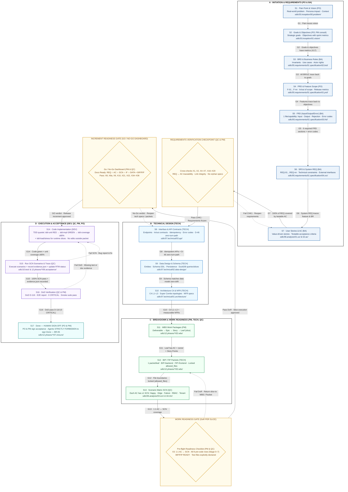
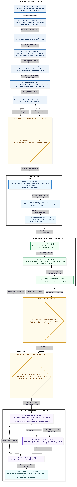

# SDLC Master Pipeline (diagram)

**Single topic:** SDLC Master Pipeline — sequential 17 stages `S1…S17`, 16 gates `G1…G16`, and 3 quantitative inspection checkpoints (**Cross-checks**, **Pre-flight DoR**, **Go / No-Go**). Strict division across 4 roles (**BA · TECH · QC · PM/PO**) with corresponding target folders under `sdlc/`. Excludes the CR pipeline (see [`02.cr-pipeline`](02.cr-pipeline.md)).

> **Rule:** [`10.main-pipeline-rule`](../01.standard/10.main-pipeline-rule.md). Upstream zoom `S1…S7`: [`03.intent-pipeline`](03.intent-pipeline.md).

## 1. Mermaid — **source of truth**

## 2. Generated image

> **Image is an artifact generated from Mermaid in §1** — do not edit manually. Regenerate:
> `npx -y @mermaid-js/mermaid-cli -p /tmp/pptr.json -i sdlc/02.governance/04.diagrams/01.main-pipeline.md -o sdlc/02.governance/04.diagrams/01.main-pipeline.png -b white -s 2`

## 3. Reference table: 17 stages, roles, published kinds, folders, and gates

| Phase / Group | Stage | Lead Role | Published Kind (`kind:`) | Standard Folder in `sdlc/` | Checkpoint / Gate Verification |
|---|---|---|---|---|---|
| **A · Requirements & Goals** | **S1** Pain / Vision | **PO** | `concept`, `charter` | `03.inception/00.problem/` · `12.phases/*/` | `G1`: Pain traces Vision |
| | **S2** Goals & Objectives | **PO (PM consult)** | `concept`, `business-case` | `03.inception/01.vision/` | `G2`: Goals + Objectives have measurable metrics (`X17`) |
| | **S3** BRD | **BA** | `brd`, `actor-catalog`, `business-rule` | `05.requirements/01.specification/02.brd/` | `G3`: Business Rules trace Goals & Pain |
| | **S4** PRD | **PO** | `prd`, `feature-catalog` | `05.requirements/01.specification/01.prd/` | `G4`: All Features trace Objectives |
| | **S5** FRD | **BA** | `frd` (input, output, rejection, error codes) | `05.requirements/01.specification/03.frd/` | `G5`: 6 required FRD sections + error codes |
| | **S6** SRS | **BA** | `srs`, `requirement` (REQ-*) | `05.requirements/01.specification/04.srs/` | `G6`: REQ traces Feature + BR |
| | **S7** US / AC | **BA** | `user-story`, `acceptance-criteria` | `06.analysis/01.us/` `06.analysis/02.ac/` | `G7`: 100% REQ covered by testable AC |
| **Requirements Checkpoint** | **CHK1** | **QC & PM** | Audit report | `02.governance/02.records/01.document-status.md` | **Cross-checks X1, X2, X4–X7, X16–X20** |
| **B · Technical Design** | **S8** Interface & API | **TECH** | `api-contract`, error catalog | `07.technical/03.api/` | `G8`: Idempotency, zero-turn-path (`D-46`) |
| | **S9** Data Design | **TECH** | `data-model`, schema, DDL | `07.technical/02.data-design/` | `G9`: Entity ↔ Schema zero-drift |
| | **S10** Architecture | **TECH** | `c4` (L1–L3), `architecture-doc`, `nfr-spec` | `07.technical/01.architecture/` `05.requirements/01.specification/05.nfr-spec/` | `G10`: C4 all levels + measurable NFRs |
| **C · Breakdown & Readiness** | **S11** WBS Planning | **PM** | `wbs`, `wbs-dictionary` | `09.wbs/` or `12.phases/*/02.wbs/` | `G11`: Leaf has AC + owner + Story Points |
| | **S12** BIP / FIP | **TECH** | `bip` (Backend), `fip` (Frontend) | `09.wbs/` or `12.phases/*/02.wbs/` | `G12`: Locked file boundaries (`allowed_files`) |
| | **S13** Test Scenarios | **QC** | `scenario-matrix` (SCN-*), `traceability-matrix` | `06.analysis/03.scn/` `06.analysis/04.rtm/` | `G13`: 1:1 AC ↔ SCN (happy, edge, error, rbac) |
| **DoR Gate (per slice)** | **CHK3** | **PM & QC** | Readiness sign-off sheet | `02.governance/01.standard/03.gates/03.pre-flight.md` | **Pre-flight DoR: X3 + all 8 pre-code rows (0–7)** |
| **Go / No-Go Gate (increment)** | **CHK2** | **PM & QC** | Increment readiness dashboard | `02.governance/01.standard/03.gates/04.go-no-go.md` | **Go / No-Go: Docs Ready (+ X8, X8a, X9, X10, X21, X22, X34–X36)** |
| **D · Execution & Acceptance** | **S14** Implementation | **DEV** | Code, Unit tests | `packages/**` or `eso/**` | `G14`: TDD Quartet (RED → GREEN → COV ≥ 80%) |
| | **S15** Verification | **QC** | `test-spec`, `evidence.json`, SCN logs | `sdlc/10.test/` · `12.phases/*/06.acceptance/` | `G15`: 100% SCN Pass + test evidence recorded |
| | **S16** DoD Review | **QC & PM** | Technical acceptance report | `12.phases/*/06.acceptance/` | `G16`: **DoD Checklist D-116** (0 CRITICAL) |
| | **S17** Done & Handover | **PO & PM** | `delivery-index`, `phase-record` | `12.phases/*/07.closure/` | **Human Sign-off** (Humans sign, agents forbidden) |

## 4. Decisions / Non-decisions

| Decided | Not decided |
|---|---|
| Stage sequence `S1…S17`, 16 gates `G1…G16`, and 3 quantitative checkpoints | Specific content inside each individual artifact |
| **Solid** arrows = unidirectional sequential authority handoff | CR loops (→ [`02.cr-pipeline`](02.cr-pipeline.md)) |
| **Dashed** arrows = rework loop when an inspection gate or QC rejects | Detailed resource staffing for sub-projects |

## 5. Subtask taxonomy — inside S14, not a separate stage

| Profile / Group | Subtask Type | Description & Purpose | Standard 3rd-party Tooling |
|---|---|---|---|
| **Core Quartet** (all Stories/Tasks) | `tdd-unit` 2 · `tdd-impl` dev · `tdd-coverage` 1 · `tdd-qc` 3 | Mandatory test-first implementation & SCN verification baseline | Vitest / Jest / Pytest · c8 / Istanbul |
| **High Assurance & Math** | `tdd-property` 3 · `tdd-mutation` 3 | Invariant verification, generative input fuzzing & test mutation score | `fast-check` / `Hypothesis` · `Stryker Mutator` / `Mutmut` |
| **Frontend UI / UX** | `tdd-visual` 2 · `tdd-a11y` 2 | Visual regression screenshot comparison & WCAG 2.1 compliance | Playwright screenshot diff · `axe-core` / Lighthouse |
| **Integration & Security** | `tdd-contract` 3 · `tdd-security` 3 | Consumer-driven API contract validation & RBAC / auth fuzzing | `Pact` / `Prism OpenAPI` · `OWASP ZAP` / Semgrep |
| **Runtime & Resilience** | `tdd-load` 5 · `tdd-stress` 5 · `tdd-chaos` 5 | Latency SLA, capacity limits & network/timeout fault injection | `k6` / Artillery · `Toxiproxy` / Testcontainers |
| Outside quartet | `tdd-perf` 5 | Long-running benchmark, **Independent Task**, not a subtask | Dedicated benchmarking harness |
| OUT | `tdd-ba` 2 | AC already finalized at S7 — duplicate and unnecessary | N/A |

## 6. Revision rule

Mermaid in §1 modified ⇒ **regenerate** `01.main-pipeline.png` in the same commit + sync to `eso/ui/public/diagrams/01.main-pipeline.png` + bump `sot_doc_version`. Never edit images by hand; if an image drifts from Mermaid, **Mermaid wins**.
