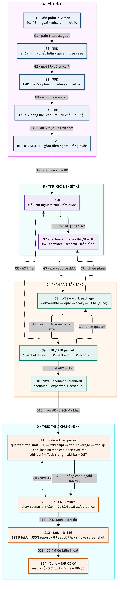

# `05` — Main SDLC pipeline (diagram)

**Một chủ đề:** thứ tự 14 bước `S1…S14` và 13 cổng `G1…G13` của pipeline chính. Không mô tả CR pipeline (xem [`06`](02.cr-pipeline.md)).

## 1. Mermaid — **nguồn sự thật**

```mermaid
%%{init: {"flowchart": {"wrappingWidth": 430, "nodeSpacing": 55, "rankSpacing": 80, "htmlLabels": true}}}%%
flowchart TD
    subgraph A["A · YÊU CẦU"]
        S1["S1 · Pain point / Vision<br/>P1–P8 → goal · mission · metric"]
        S2["S2 · BRD<br/>ai đau · luật bất biến · quyền · use case"]
        S3["S3 · PRD<br/>F-01…F-27 · phạm vi release · metric"]
        S4["S4 · FRD<br/>1 file / năng lực: vào · ra · từ chối · dữ liệu"]
        S5["S5 · SRS<br/>REQ-01…REQ-35 · giao diện ngoài · ràng buộc"]
    end
    subgraph B["B · TIÊU CHÍ & THIẾT KẾ"]
        S6["S6 · US / AC<br/>tiêu chí nghiệm thu kiểm được"]
        S7["S7 · Technical planes B/C/D + UI<br/>C4 · contract · schema · màn hình"]
    end
    subgraph C["C · PHÂN RÃ & SẴN SÀNG"]
        S8["S8 · WBS — work package<br/>deliverable → epic → story → LEAF (slice)"]
        S9["S9 · BIP / FIP packet<br/>1 packet / leaf · BIP=backend · FIP=frontend"]
        S10["S10 · SCN — scenario (planned)<br/>scenario + expected + test file"]
    end
    subgraph D["D · THỰC THI & CHỨNG MINH"]
        S11["S11 · Code — theo packet<br/>quartet: tdd-unit RED → tdd-impl → tdd-coverage → tdd-qc<br/>+ tdd-load/stress cho slice runtime<br/>tdd-perf = Task riêng · tdd-ba = OUT"]
        S12["S12 · Run SCN → trace<br/>chạy scenario + cập nhật SCN status/evidence"]
        S13["S13 · DoD — D-116<br/>E2E 9 bước · JSON report · 6 test cô lập · smoke screenshot"]
        S14["S14 · Done — NGƯỜI KÝ<br/>máy KHÔNG được ký Done — BR-05"]
    end

    S1 -->|"G1 · pain trace ≥1 goal"| S2
    S2 -->|"G2 · mọi BR/UC trace P"| S3
    S3 -->|"G3 · mọi F trace P + G"| S4
    S4 -->|"G4 · F đủ 6 mục + ≥1 từ chối"| S5
    S5 -->|"G5 · REQ trace F + BR"| S6
    S6 -->|"G6 · mọi REQ có ≥1 AC"| S7
    S7 -->|"G7 · packet cite được"| S8
    S8 -->|"G8 · leaf có AC + owner + size"| S9
    S9 -->|"G9 · §9 READY = DoR"| S10
    S10 -->|"G10 · mọi AC có SCN đã khai"| S11
    S11 -->|"G11 · không code ngoài packet"| S12
    S12 -->|"G12 · SCN xanh · RTM đủ"| S13
    S13 -->|"G13 · đủ 4 điều kiện thoát"| S14

    S9 -.->|"CR · AC thiếu"| S6
    S9 -.->|"CR · slice quá lớn"| S8
    S8 -.->|"CR · thiếu plane"| S7
    S12 -.->|"CR · SCN đỏ"| S11

    classDef req fill:#EAF1F8,stroke:#1F4E79,stroke-width:2px,color:#111111
    classDef crit fill:#F3EAF9,stroke:#7030A0,stroke-width:2px,color:#111111
    classDef ready fill:#E6F4F1,stroke:#0F7B6C,stroke-width:2px,color:#111111
    classDef exec fill:#FDF0E6,stroke:#C55A11,stroke-width:2px,color:#111111
    class S1,S2,S3,S4,S5 req
    class S6,S7 crit
    class S8,S9,S10 ready
    class S11,S12,S13,S14 exec
```

## 2. Ảnh sinh ra

> **Ảnh là artifact sinh ra từ Mermaid ở §1** — không sửa tay. Regenerate:
> `npx -y @mermaid-js/mermaid-cli -p /tmp/pptr.json -i sdlc/02.governance/04.diagrams/01.main-pipeline.md -o /tmp/out.png -s 2 -b white
> (mermaid-cli xuất `/tmp/out-1.png` cho file markdown — copy về `01.main-pipeline.png`)`
> (pptr.json = `{"executablePath": "/Applications/Google Chrome.app/Contents/MacOS/Google Chrome"}`).

## 3. Quyết định / không quyết định

| Quyết định | Không quyết định |
|---|---|
| thứ tự bước và **cổng** giữa các bước | nội dung từng bước (→ `01.document-status` §2.1–2.2) |
| mũi tên **liền** = quyền lực một chiều | vòng lặp CR (→ [`06`](02.cr-pipeline.md)) |
| nhãn `CR …` trên mũi tên đứt = vòng bổ sung chéo | trạng thái/cổng của CR (→ `01.document-status` §2.5) |

## 3.1 Subtask taxonomy — nằm **trong** S11, không phải stage riêng

| Nhóm | Loại | Ghi chú |
|---|---|---|
| Quartet (mọi Story/Task) | `tdd-unit` 2 · `tdd-impl` dev · `tdd-coverage` 1 · `tdd-qc` 3 | pipeline S11 |
| Runtime slice | `tdd-load` 5 · `tdd-stress` 5 | chỉ `ESO-525/528/531`; đo hệ đang chạy |
| Ngoài quartet | `tdd-perf` 5 | **Task độc lập** (`ESO-606`), không subtask |
| OUT | `tdd-ba` 2 | AC đã rõ — tạo là thừa |

## 4. Revision rule

Mermaid ở §1 đổi ⇒ **render lại** `01.main-pipeline.png` trong cùng thay đổi + bump `sot_doc_version`. Ảnh không được sửa tay;
nếu ảnh khác Mermaid thì **Mermaid thắng**.
