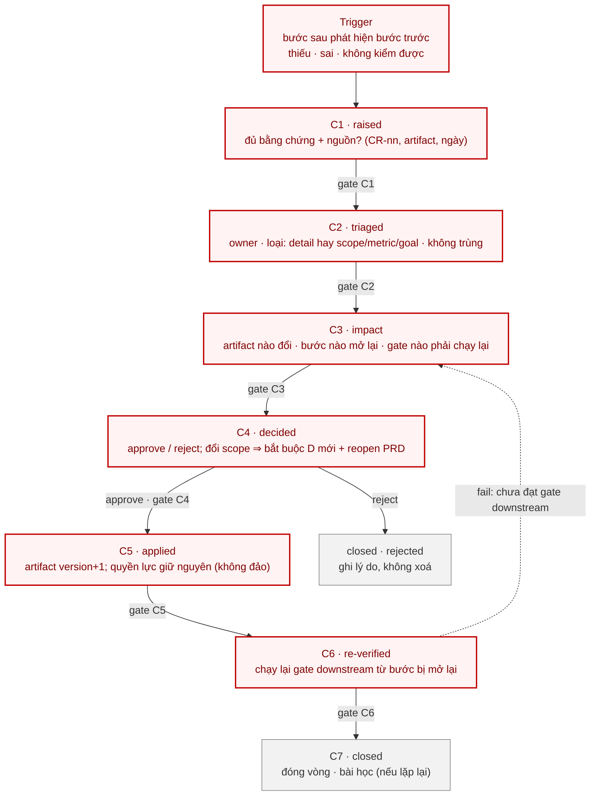
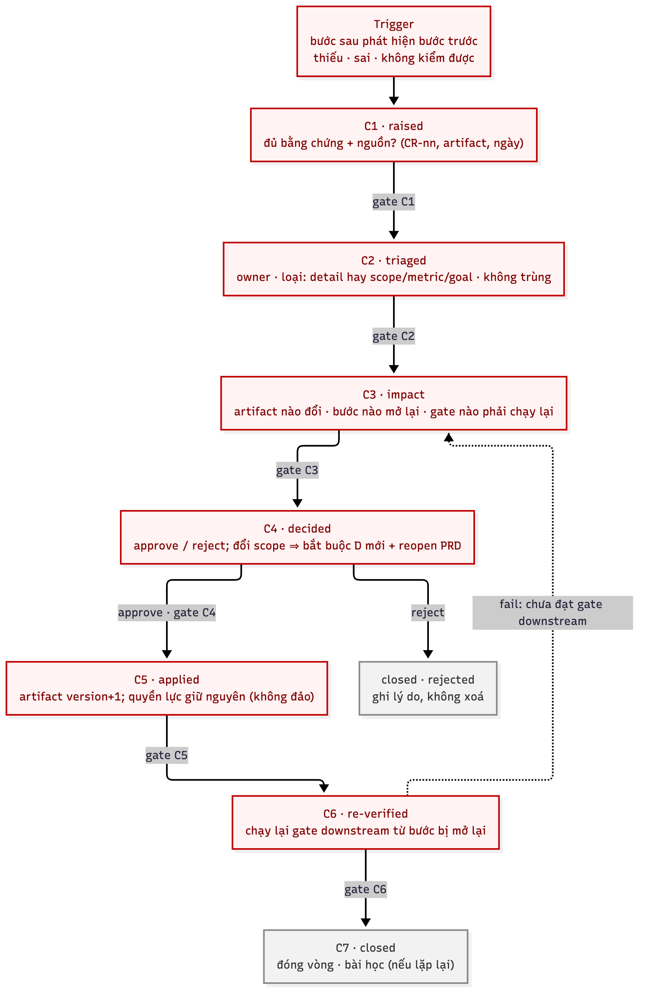

# `06` — CR pipeline (diagram)

**Một chủ đề:** flow xử lý một change request: `raised → triaged → impacted → decided → applied → re-verified → closed` (hoặc `rejected`).

## 1. Mermaid — **nguồn sự thật**

## 2. Ảnh sinh ra

> **Ảnh là artifact sinh ra từ Mermaid ở §1** — không sửa tay. Regenerate:
> `npx -y @mermaid-js/mermaid-cli -p pptr.json -i 06.cr-pipeline.mmd -o 06.cr-pipeline.png -b white -s 2`

## 3. Quyết định / không quyết định

| Quyết định | Không quyết định |
|---|---|
| thứ tự trạng thái `C1…C7` và điều kiện qua cổng | **bước nào bị mở lại** sau CR (→ `01.document-status` §2.5.3) |
| nhánh `rejected` và vòng `fail → C3` | pipeline chính (→ [`05`](01.main-pipeline.md)) |
| CR có **người quyết** ở `C4` | nội dung artifact cụ thể (→ file bị mở lại) |

## 4. Revision rule

Mermaid ở §1 đổi ⇒ **render lại** `06.cr-pipeline.png` trong cùng thay đổi + bump `sot_doc_version`. Ảnh không sửa tay;
Mermaid thắng nếu lệch.
