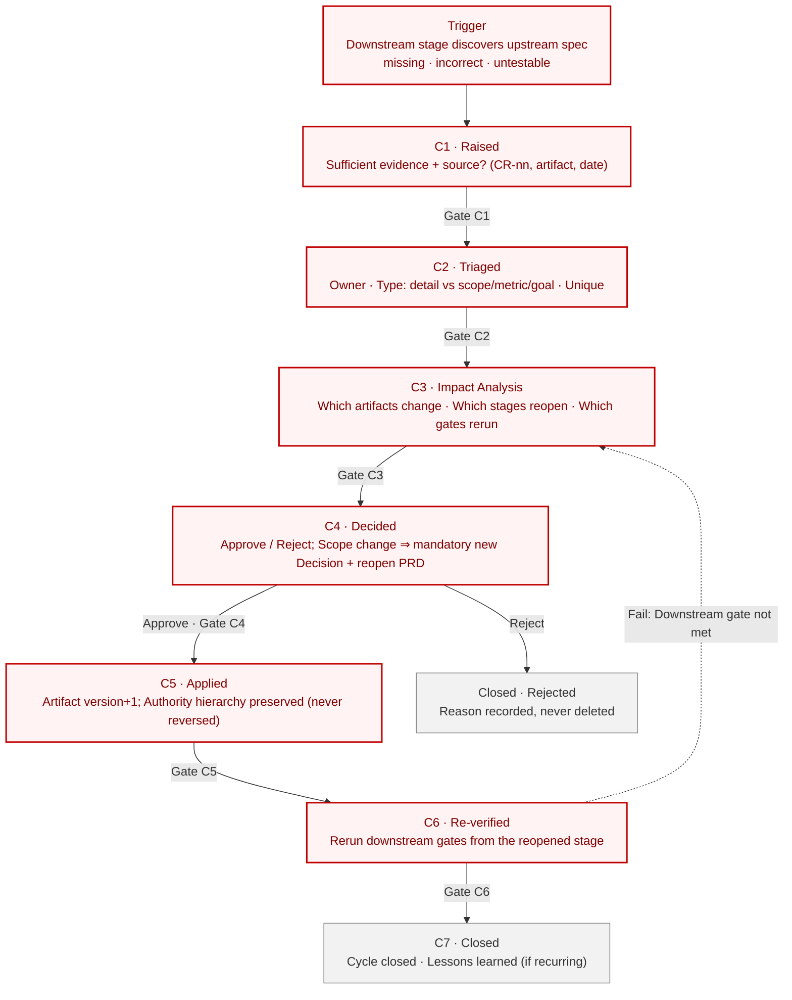
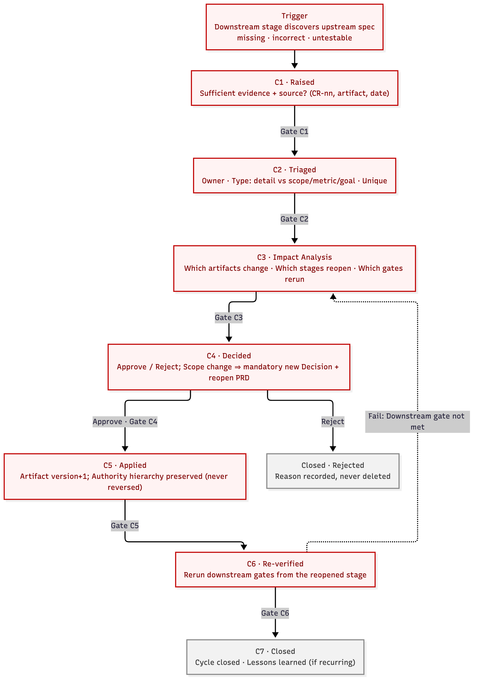

# `06` — Change Request Pipeline (diagram)

**Single topic:** Workflow for handling a Change Request (CR): `raised → triaged → impacted → decided → applied → re-verified → closed` (or `rejected`).

## 1. Mermaid — **source of truth**

## 2. Generated image

> **Image is an artifact generated from Mermaid in §1** — do not edit manually. Regenerate:
> `npx -y @mermaid-js/mermaid-cli -p /tmp/pptr.json -i sdlc/02.governance/04.diagrams/02.cr-pipeline.md -o sdlc/02.governance/04.diagrams/02.cr-pipeline.png -b white -s 2`

## 3. Decisions / Non-decisions

| Decided | Not decided |
|---|---|
| State lifecycle `C1…C7` and gate passing conditions | **Which exact stage is reopened** after CR (→ `01.document-status` §2.5.3) |
| `Rejected` branch and `fail → C3` loop | Main SDLC pipeline sequence (→ [`01.main-pipeline`](01.main-pipeline.md)) |
| CR requires a **human decider** at `C4` | Specific artifact content changes (→ the reopened file) |

## 4. Revision rule

Mermaid in §1 modified ⇒ **regenerate** `02.cr-pipeline.png` in the same commit + sync to `eso/ui/public/diagrams/02.cr-pipeline.png` + bump `sot_doc_version`. Never edit images by hand; Mermaid wins if there is drift.
