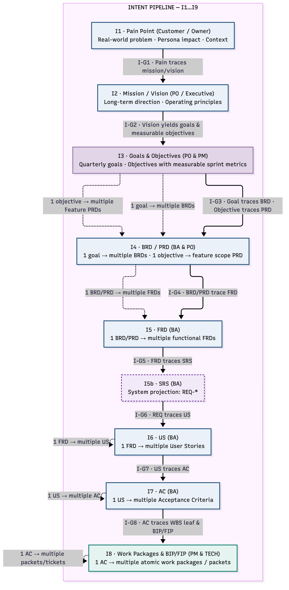

# `03` — Intent Pipeline (upstream view)

**Single topic:** Pipeline of **intent → measurable objectives → testable requirements**. This is a **zoom-in of `S1…S7`** in [`01.main-pipeline`](01.main-pipeline.md), **NOT** a parallel pipeline.

## 1. Mermaid — **source of truth**

```mermaid
%%{init: {"flowchart": {"wrappingWidth": 440, "nodeSpacing": 45, "rankSpacing": 70, "htmlLabels": true}}}%%
flowchart TD
    subgraph P["INTENT PIPELINE — I1…I9"]
        I1["I1 · Pain Point (Customer / Owner)<br/>Real-world problem · Persona impact · Context"]
        I2["I2 · Mission / Vision (PO / Executive)<br/>Long-term direction · Operating principles"]
        I3["I3 · Goals & Objectives (PO & PM)<br/>Quarterly goals · Objectives with measurable sprint metrics"]
        I4["I4 · BRD / PRD (BA & PO)<br/>1 goal → multiple BRDs · 1 objective → feature scope PRD"]
        I5["I5 · FRD (BA)<br/>1 BRD/PRD → multiple functional FRDs"]
        I5b["I5b · SRS (BA)<br/>System projection: REQ-*"]
        I6["I6 · US (BA)<br/>1 FRD → multiple User Stories"]
        I7["I7 · AC (BA)<br/>1 US → multiple Acceptance Criteria"]
        I8["I8 · Work Packages & BIP/FIP (PM & TECH)<br/>1 AC → multiple atomic work packages / packets"]
    end

    I1 -->|"I-G1 · Pain traces mission/vision"| I2
    I2 -->|"I-G2 · Vision yields goals & measurable objectives"| I3
    I3 -->|"I-G3 · Goal traces BRD · Objective traces PRD"| I4
    I4 -->|"I-G4 · BRD/PRD trace FRD"| I5
    I5 -->|"I-G5 · FRD traces SRS"| I5b
    I5b -->|"I-G6 · REQ traces US"| I6
    I6 -->|"I-G7 · US traces AC"| I7
    I7 -->|"I-G8 · AC traces WBS leaf & BIP/FIP"| I8

    I3 -.->|"1 goal → multiple BRDs"| I4
    I3 -.->|"1 objective → multiple Feature PRDs"| I4
    I4 -.->|"1 BRD/PRD → multiple FRDs"| I5
    I6 -.->|"1 FRD → multiple US"| I6
    I7 -.->|"1 US → multiple AC"| I7
    I8 -.->|"1 AC → multiple packets/tickets"| I8

    classDef intent fill:#EAF1F8,stroke:#1F4E79,stroke-width:2px,color:#111111
    classDef goal fill:#E1D5E7,stroke:#9673A6,stroke-width:2px,color:#111111
    classDef system fill:#F3EAF9,stroke:#7030A0,stroke-width:2px,stroke-dasharray:4 3,color:#111111
    classDef deliver fill:#E6F4F1,stroke:#0F7B6C,stroke-width:2px,color:#111111
    class I1,I2 intent
    class I3 goal
    class I4,I5,I6,I7 intent
    class I5b system
    class I8 deliver
```

## 2. Generated image

> `I5b · SRS` is the **system projection** between FRD and US. ESO preserves SRS because `REQ-*` traces both `F` and `BR`;
> if a variant omits SRS, it proceeds directly `FRD → US`, but must be explicitly declared.
> Addition of `I3 · Goals & Objectives`: prevents jumping from Pain directly to feature writing without quantified success criteria.

## 3. Mapping to main pipeline

| Intent | Main Pipeline | Lead Role | Notes |
|---|---|---|---|
| `I1` Pain | `S1` | Owner / PO | Pain traces Vision |
| `I2` Mission / Vision | `S1` | PO / Executive | Long-term strategic principles |
| `I3` Goals & Objectives | `S2` | PO / PM | Falsifiable goals + objectives with measurable metrics (`X17`) |
| `I4` BRD / PRD | `S3` + `S4` | BA (BRD) · PO (PRD) | 1 goal → multiple BRDs; 1 objective → feature scope PRD |
| `I5` FRD | `S5` | BA | 1 BRD/PRD → multiple functional FRDs |
| `I5b` SRS | `S6` | BA | System projection: REQ-* |
| `I6` US | `S7` | BA | 1 FRD → multiple User Stories |
| `I7` AC | `S7` | BA | 1 US → multiple testable Acceptance Criteria |
| `I8` Ticket / BIP/FIP | `S11` + `S12` | PM & TECH | 1 AC → multiple atomic tickets / packets with locked `allowed_files` |

## 4. Invariant rules

1. `I1…I8` is a **mandatory sequence**; skipping layers is strictly forbidden.
2. Each layer MUST trace back upstream to its parent; tickets without AC are invalid.
3. Cardinality: 1 goal → multiple BRDs; 1 objective → multiple PRDs; 1 BRD/PRD → multiple FRDs; 1 FRD → multiple US; 1 US → multiple AC; 1 AC → multiple packets/tickets.
4. Any gap discovered at `I1…I5` MUST NOT be patched via code/tickets; the missing document layer MUST be reopened.
5. `I8` tickets MUST be atomic and trace exactly one `I7` AC (or a decomposed AC slice).
6. Complete normative rule: [`09.pipeline-trace`](../01.standard/09.pipeline-trace.md).
