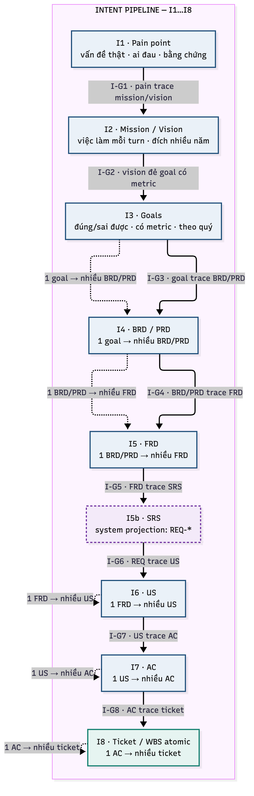

# `03` — Intent Pipeline (upstream view)

**Một chủ đề:** pipeline **ý định → yêu cầu kiểm được**. Đây là **zoom-in của `S1…S7`** trong
[`01.main-pipeline`](01.main-pipeline.md), **không** phải pipeline song song.

## 1. Mermaid — nguồn sự thật

```mermaid
%%{init: {"flowchart": {"wrappingWidth": 420, "nodeSpacing": 45, "rankSpacing": 70, "htmlLabels": true}}}%%
flowchart TD
    subgraph P["INTENT PIPELINE — I1…I8"]
        I1["I1 · Pain point<br/>vấn đề thật · ai đau · bằng chứng"]
        I2["I2 · Mission / Vision<br/>việc làm mỗi turn · đích nhiều năm"]
        I3["I3 · Goals<br/>đúng/sai được · có metric · theo quý"]
        I4["I4 · BRD / PRD<br/>1 goal → nhiều BRD/PRD"]
        I5["I5 · FRD<br/>1 BRD/PRD → nhiều FRD"]
        I5b["I5b · SRS<br/>system projection: REQ-*"]
        I6["I6 · US<br/>1 FRD → nhiều US"]
        I7["I7 · AC<br/>1 US → nhiều AC"]
        I8["I8 · Ticket / WBS atomic<br/>1 AC → nhiều ticket"]
    end

    I1 -->|"I-G1 · pain trace mission/vision"| I2
    I2 -->|"I-G2 · vision đẻ goal có metric"| I3
    I3 -->|"I-G3 · goal trace BRD/PRD"| I4
    I4 -->|"I-G4 · BRD/PRD trace FRD"| I5
    I5 -->|"I-G5 · FRD trace SRS"| I5b
    I5b -->|"I-G6 · REQ trace US"| I6
    I6 -->|"I-G7 · US trace AC"| I7
    I7 -->|"I-G8 · AC trace ticket"| I8

    I3 -.->|"1 goal → nhiều BRD/PRD"| I4
    I4 -.->|"1 BRD/PRD → nhiều FRD"| I5
    I6 -.->|"1 FRD → nhiều US"| I6
    I7 -.->|"1 US → nhiều AC"| I7
    I8 -.->|"1 AC → nhiều ticket"| I8

    classDef intent fill:#EAF1F8,stroke:#1F4E79,stroke-width:2px,color:#111111
    classDef system fill:#F3EAF9,stroke:#7030A0,stroke-width:2px,stroke-dasharray:4 3,color:#111111
    classDef deliver fill:#E6F4F1,stroke:#0F7B6C,stroke-width:2px,color:#111111
    class I1,I2,I3,I4,I5,I6,I7 intent
    class I5b system
    class I8 deliver
```

> `I5b · SRS` là **system projection** giữa FRD và US. ESO giữ SRS vì `REQ-*` trace `F` + `BR`;
> nếu một biến thể bỏ SRS thì `FRD → US` trực tiếp, nhưng phải khai rõ.

## 2. Mapping sang main pipeline

| Intent | Main pipeline | Ghi chú |
|---|---|---|
| `I1` Pain | `S1` | pain trace goal |
| `I2` Mission/Vision | `S1` | mission/vision không phải goal |
| `I3` Goals | `S1` | goal + metric |
| `I4` BRD/PRD | `S2` + `S3` | 1 goal → nhiều BRD/PRD |
| `I5` FRD | `S4` | 1 BRD/PRD → nhiều FRD |
| `I5b` SRS | `S5` | system projection |
| `I6` US | `S6` | 1 FRD → nhiều US |
| `I7` AC | `S6` | 1 US → nhiều AC |
| `I8` Ticket/WBS | `S8` + `S9` | 1 AC → nhiều ticket atomic |

## 3. Luật

1. `I1…I8` là **thứ tự bắt buộc**; không nhảy tầng.
2. Mỗi tầng phải trace ngược lên tầng trên; ticket không có AC ⇒ không tồn tại.
3. Cardinality: 1 goal → nhiều BRD/PRD; 1 BRD/PRD → nhiều FRD; 1 FRD → nhiều US; 1 US → nhiều AC; 1 AC → nhiều ticket.
4. Gap ở `I1…I5` **không** được sửa bằng ticket; mở lại đúng tầng.
5. `I8` ticket phải atomic và trace đúng một `I7` AC (hoặc phần AC được cắt).
6. Rule đầy đủ: [`09.pipeline-trace`](../01.standard/09.pipeline-trace.md).
