# `03` — Intent Pipeline (upstream view)

**Một chủ đề:** pipeline **ý định → mục tiêu đo lường được → yêu cầu kiểm chứng được**. Đây là **zoom-in của `S1…S7`** trong [`01.main-pipeline`](01.main-pipeline.md), **không** phải pipeline song song.

## 1. Mermaid — nguồn sự thật

```mermaid
%%{init: {"flowchart": {"wrappingWidth": 440, "nodeSpacing": 45, "rankSpacing": 70, "htmlLabels": true}}}%%
flowchart TD
    subgraph P["INTENT PIPELINE — I1…I9"]
        I1["I1 · Pain point (Khách hàng / Owner)<br/>vấn đề thực tế · ai đau · bối cảnh"]
        I2["I2 · Mission / Vision (PO / C-Level)<br/>định hướng dài hạn · nguyên tắc vận hành"]
        I3["I3 · Goals & Objectives (PO & PM)<br/>Goal cấp quý · Objective có metric đo lường cấp sprint"]
        I4["I4 · BRD / PRD (BA & PO)<br/>1 goal → nhiều BRD · 1 objective → feature scope PRD"]
        I5["I5 · FRD (BA)<br/>1 BRD/PRD → nhiều FRD chức năng"]
        I5b["I5b · SRS (BA)<br/>system projection: REQ-*"]
        I6["I6 · US (BA)<br/>1 FRD → nhiều User Stories"]
        I7["I7 · AC (BA)<br/>1 US → nhiều Acceptance Criteria"]
        I8["I8 · Work Packages & BIP/FIP (PM & TECH)<br/>1 AC → nhiều work package / packet atomic"]
    end

    I1 -->|"I-G1 · pain trace mission/vision"| I2
    I2 -->|"I-G2 · vision đẻ goal & objective có metric"| I3
    I3 -->|"I-G3 · goal trace BRD · objective trace PRD"| I4
    I4 -->|"I-G4 · BRD/PRD trace FRD"| I5
    I5 -->|"I-G5 · FRD trace SRS"| I5b
    I5b -->|"I-G6 · REQ trace US"| I6
    I6 -->|"I-G7 · US trace AC"| I7
    I7 -->|"I-G8 · AC trace WBS leaf & BIP/FIP"| I8

    I3 -.->|"1 goal → nhiều BRD"| I4
    I3 -.->|"1 objective → nhiều Feature PRD"| I4
    I4 -.->|"1 BRD/PRD → nhiều FRD"| I5
    I6 -.->|"1 FRD → nhiều US"| I6
    I7 -.->|"1 US → nhiều AC"| I7
    I8 -.->|"1 AC → nhiều packet/ticket"| I8

    classDef intent fill:#EAF1F8,stroke:#1F4E79,stroke-width:2px,color:#111111
    classDef goal fill:#E1D5E7,stroke:#9673A6,stroke-width:2px,color:#111111
    classDef system fill:#F3EAF9,stroke:#7030A0,stroke-width:2px,stroke-dasharray:4 3,color:#111111
    classDef deliver fill:#E6F4F1,stroke:#0F7B6C,stroke-width:2px,color:#111111
    class I1,I2 intent
    class I3 goal
    class I4,I5,I6,I7 intent
    class I5b system
    class I8 deliver
```

## 2. Ảnh sinh ra

> `I5b · SRS` là **system projection** giữa FRD và US. ESO giữ SRS vì `REQ-*` trace `F` + `BR`;
> nếu một biến thể bỏ SRS thì `FRD → US` trực tiếp, nhưng phải khai rõ.
> Bổ sung `I3 · Goals & Objectives`: ngăn chặn việc nhảy cóc từ Pain sang viết tính năng khi chưa có chỉ số đo lường thành công.

## 3. Mapping sang main pipeline

| Intent | Main pipeline | Role chủ trì | Ghi chú |
|---|---|---|---|
| `I1` Pain | `S1` | Owner / PO | pain trace vision |
| `I2` Mission/Vision | `S1` | PO / C-Level | nguyên tắc định hướng dài hạn |
| `I3` Goals & Objectives | `S2` | PO / PM | goal đúng/sai được + objective kèm metric đo lường (`X17`) |
| `I4` BRD / PRD | `S3` + `S4` | BA (BRD) · PO (PRD) | 1 goal → nhiều BRD; 1 objective → feature scope PRD |
| `I5` FRD | `S5` | BA | 1 BRD/PRD → nhiều FRD chức năng |
| `I5b` SRS | `S6` | BA | system projection: REQ-* |
| `I6` US | `S7` | BA | 1 FRD → nhiều User Stories |
| `I7` AC | `S7` | BA | 1 US → nhiều Acceptance Criteria kiểm được |
| `I8` Ticket / BIP/FIP | `S11` + `S12` | PM & TECH | 1 AC → nhiều ticket / packet atomic khóa `allowed_files` |

## 4. Luật

1. `I1…I8` là **thứ tự bắt buộc**; tuyệt đối không nhảy tầng.
2. Mỗi tầng phải trace ngược lên tầng trên; ticket không có AC ⇒ không hợp lệ.
3. Cardinality: 1 goal → nhiều BRD; 1 objective → nhiều PRD; 1 BRD/PRD → nhiều FRD; 1 FRD → nhiều US; 1 US → nhiều AC; 1 AC → nhiều packet/ticket.
4. Mọi khoảng trống (gap) ở `I1…I5` **không** được sửa bằng ticket/code; bắt buộc mở lại đúng tầng tài liệu bị thiếu.
5. `I8` ticket phải atomic và trace đúng một `I7` AC (hoặc phần AC được phân rã).
6. Rule đầy đủ: [`09.pipeline-trace`](../01.standard/09.pipeline-trace.md).
