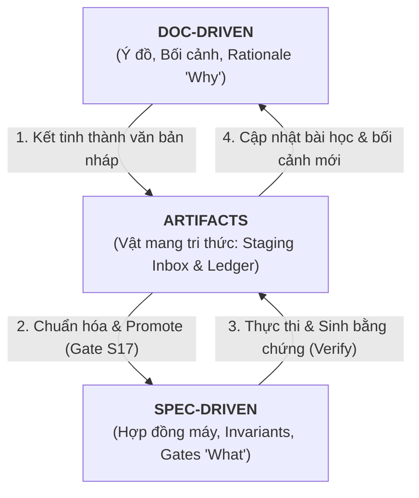

# 12 — Document-Driven vs Spec-Driven: Tương quan, Đối xứng, Phân loại Artifacts & Kiến trúc Knowledge Governance

**Ngày:** 2026-11-26 · **Nguồn:** Operator chỉ đạo phân tích chuyên sâu mối quan hệ giữa xu hướng AI, Spec-Driven Development (SDD), Document-Driven Development, phân loại các nhóm Artifacts, trục đối xứng SDLC hoàn chỉnh (có `08.wbs`, điểm bản lề `06.analysis`, feedback loop), và ma trận rủi ro / tác dụng phụ kỹ thuật.

---

## 1. Bản chất & Điểm tương đồng giữa Tab Knowledge và Spec-Driven

Tab `Knowledge & artifact governance` (`/consumers/:id/settings?tab=knowledge`) tại cổng 4200 tổ chức tri thức thành **6 section logic**: `overview`, `artifacts`, `sources`, `contract`, `index`, `manifest`.

Cốt lõi của **Spec-Driven Development (SDD)**: Đặc tả (spec) là nguồn sự thật duy nhất (Source of Truth), mã nguồn là sản phẩm phái sinh (derivative) và hành vi thực thi phải bị ràng buộc, kiểm chứng tự động đối chiếu với spec.

Bảng ánh xạ cấu trúc 6 section của Tab Knowledge vào kiến trúc SDD:

| Section trên UI | Thành phần trong Spec-Driven | Vai trò logic & Kỹ thuật |
|---|---|---|
| **`sources`** | **Spec Repository** | Định vị chính xác nơi cư trú của các tệp đặc tả chính thức trong repo (`sdlc/`), ngăn chặn tri thức tản mát ngoài tầm kiểm soát. |
| **`contract`** *(S1–S17, G1–G16, X1–X42)* | **Meta-Spec / Schema Linter** | Định nghĩa "luật của spec": các stage phải đi qua, phân định vai trò chịu trách nhiệm (PO, BA, TECH, PM, DEV, QC, HUMAN), và 42 phép kiểm tra tính toàn vẹn. |
| **`index`** *(KM-01…KM-06)* | **Spec Compiler & Doc Graph** | Bộ phân tích cú pháp (parser) chuyển văn bản thô thành đồ thị tri thức (Doc Graph), kiểm tra liên kết gãy, thiếu anchor, thiếu header ID. |
| **`manifest`** | **Frozen Contract / Build Artifact** | Đóng băng toàn bộ tri thức thành snapshot có định danh và hash SHA-256 (`knowledge-manifest.json`), làm căn cứ bất biến để audit, RAG và gate. |
| **`artifacts`** | **Living Artifacts Ledger & Staging Inbox** | Quản lý sổ cái các artifacts đang sống, phân tách giữa cấu hình runtime do host sinh và các tài liệu nghiên cứu của người dùng/AI. |
| **`overview`** | **Preflight & Verification Dashboard** | Báo cáo mức độ sẵn sàng, chạy preflight checks (PASS/FAIL) và tổng hợp sức khỏe của toàn bộ tri thức. |

> **Điểm tương đồng căn bản:** Cả hai đều từ chối coi "code là chân lý duy nhất", và đều xây dựng cơ chế kiểm tra tự động (linter/compiler) để phát hiện mâu thuẫn trong mô tả trước khi bước vào viết code.

---

## 2. Đánh giá tải trọng: Tab Knowledge có quá "heavy" cho Document-Driven?

* **Đối với Document-Driven truyền thống (Human-only):** **Quá tải (Over-engineered).** Con người có khả năng tự bù đắp thông tin thiếu sót và tự thích ứng với sự mờ nghĩa của ngôn ngữ tự nhiên. Việc bắt buộc 42 cross-check, 17 stage và snapshot manifest là rào cản hành chính gây chậm tiến độ nếu chỉ phục vụ đội ngũ dev thuần người.
* **Đối với Document-Driven trong kỷ nguyên AI Agentic:** **Vừa vặn và tất yếu.** AI không thể tự suy luận an toàn khi tài liệu tự do ("vibe coding" dẫn tới hallucination và trôi dạt ngữ cảnh). AI cần văn bản tự nhiên để hiểu **Bối cảnh lớn (Context)**, nhưng bắt buộc phải có **Ràng buộc cấu trúc (Anchors, IDs, Gate)** để khóa phạm vi hành động.
* **Bản chất của bộ `tab=knowledge`:** Là một **Bộ Biên Dịch Tri Thức (Knowledge Compiler)**. Nó nhận đầu vào là **Document** (Markdown giàu ngữ cảnh cho người đọc) và chuyển hóa thành **Spec** (dữ liệu máy có thể kiểm chứng, băm hash và ép buộc đối với Agent).

---

## 3. So sánh Document-Driven vs Spec-Driven

| Trục so sánh | **Document-Driven (Doc-Driven)** | **Specification-Driven (Spec-Driven)** |
|---|---|---|
| **Bản chất** | Tiếp cận bằng *văn bản tự nhiên & câu chuyện (Narrative & Context)* | Tiếp cận bằng *hợp đồng hình thức & ràng buộc máy đọc (Formal Contract & Schema)* |
| **Định dạng chính** | Markdown, PRD, ADR, RFC, User Story, flow diagram | OpenAPI, JSON Schema, Proto, Gherkin/AC, State Machine, DDL |
| **Câu hỏi trọng tâm** | **Tại sao (Why)** và **Bối cảnh gì (Context)** | **Cái gì (What)** và **Điều kiện biên nào (Invariants)** |
| **Đối tượng tiêu thụ** | Con người: PM, KTS, Dev, Stakeholders suy luận mở | Máy móc: Compilers, Linters, CI/CD Gates, Deterministic AI Agents |
| **Phương thức kiểm chứng** | Đọc hiểu, thảo luận thiết kế, phê duyệt ngang hàng | Tự động hóa qua test runners, schema validators (PASS/FAIL) |

### 3.1. Khi nào Document-Driven TỐT HƠN Spec-Driven?
1. **Giai đoạn khám phá & định hướng ban đầu (Inception / Discovery):** Khi bài toán chưa rõ nét, cần thảo luận về Vision, Pain points, User Persona, Trade-offs kiến trúc. Viết formal spec quá sớm sẽ tạo ra sự cứng nhắc và lãng phí khi thay đổi định hướng.
2. **Sự thấu hiểu của con người (Human Alignment & Decision Records):** Ghi lại lý do vì sao chọn phương án này mà bỏ phương án kia (ADR, Decision Log). Spec chỉ nói "hệ thống có thuộc tính X", Document trả lời "tại sao X tồn tại".
3. **Nhiệm vụ có phạm vi mở (Open-ended reasoning):** Nạp tri thức miền nghiệp vụ (Domain Knowledge) để Agent hiểu bức tranh tổng thể trước khi nhận nhiệm vụ chi tiết.

### 3.2. Khi nào Document-Driven TỆ HƠN Spec-Driven?
1. **Giao việc cho AI thực thi (Agent Implementation):** Văn bản tự nhiên luôn có độ mờ nghĩa. AI đọc Document sẽ có xu hướng suy diễn. Spec-Driven kẹp chặt bằng I/O schema, test case, acceptance criteria cụ thể giúp AI thực thi chính xác và không vượt quyền.
2. **Kiểm thử tự động & CI/CD (Verification & Determinism):** Document không thể tự động compile, không thể sinh mock data hay test suite tự động. Spec-Driven cho phép máy kiểm tra PASS/FAIL ngay lập tức.
3. **Thành phần nhạy cảm về hợp đồng (Contract-critical):** Phân quyền (IAM, RBAC), giao dịch tài chính, API giữa các hệ thống độc lập, database schema migration. Ở các vùng này, dùng Document tự do rất dễ gãy vỡ hệ thống do thiếu tính cưỡng chế.

---

## 4. Phân loại Chuyên sâu các Nhóm Artifacts trong Hệ thống

Theo mô hình quản trị tri thức [AM-02](../03.inception/03.artifact-model/02.model.md), một Artifact được xác định bởi 6 facet độc lập:
* **`kind`**: Catalogue đóng (`PRD`, `RFC`, `ADR`, `SCHEMA`, `PROJECTION`, `TEST`...).
* **`origin`**: Chủ thể tạo (`human`, `agent`, `machine`).
* **`custodian`**: Nơi lưu giữ Source of Truth (`repo`, `staging-inbox`, `host-local`).
* **`kt-state`**: Trạng thái tri thức (`raw` $\to$ `proposed` $\to$ `approved` $\to$ `retired`).
* **`liveness`**: Tính chất tồn tại (`living` - đang tiến hóa, hay `frozen` - bất biến).
* **`authority`**: Mức độ hiệu lực (`source` - nguồn chân lý, hay `derived` - phái sinh).

```text
┌──────────────────────────────────────────────────────────────────────────────────┐
│                             HỆ THỐNG PHÂN LOẠI ARTIFACTS                         │
├────────────────────────┬─────────────────────────┬───────────────────────────────┤
│ NHÓM 1: RUNTIME        │ NHÓM 2: WORKING         │ NHÓM 3: FORMAL                │
│ (Host Projections)     │ (Research & Spikes)     │ (Canonical Contracts)         │
├────────────────────────┼─────────────────────────┼───────────────────────────────┤
│ • .cursor/rules/*.mdc  │ • Deep-dive analyses    │ • OpenAPI specs (YAML/JSON)   │
│ • .agents/rules/*.md   │ • Kiến trúc đề xuất RFC │ • Database DDL migrations     │
│ • AGENTS.local.md      │ • Spike POC, test matrix│ • Core Invariants & Rules     │
│ • hooks.json           │ • Bản nháp PRD / ADR    │ • knowledge-manifest.json     │
├────────────────────────┼─────────────────────────┼───────────────────────────────┤
│ Origin: `machine`      │ Origin: `user`|`agent`  │ Origin: `human` / `approved`  │
│ Custodian: `host-local`│ Custodian: `staging`    │ Custodian: `repo` (`sdlc/`)   │
│ Vòng đời: Ephemeral    │ Vòng đời: Sống (Living) │ Vòng đời: Bất biến (Frozen)   │
│ Authority: Derived     │ Authority: Living draft │ Authority: Source (Chân lý)   │
│ Luật: Zero-drift check │ Luật: Cần human promote │ Luật: Khóa hash SHA-256       │
└────────────────────────┴─────────────────────────┴───────────────────────────────┘
```

---

## 5. Ma trận Tác động & Vòng lặp Khép kín: Doc-Driven ↔ Spec-Driven ↔ Artifacts

Mối quan hệ giữa ba thành tố này là một **Vòng lặp Phản hồi Kín (Closed Feedback Loop)**:



### Chuỗi Nhân Quả, Giao Thoa & Tổ Hợp Liên Tab (A → B → C → D)

Trong hệ thống vận hành thực tế của ESO, tri thức không nhảy cóc mà bắt buộc phải đi qua **chuỗi điều kiện nhân quả (Causal Pipeline)**:

```text
[ BƯỚC 1: KHỞI TẠO SESSION ] ──► [ BƯỚC 2: HỘP THƯ STAGING ] ──► [ BƯỚC 3: PHÊ DUYỆT HUMAN ] ──► [ BƯỚC 4: TỔ HỢP 3 ĐÍCH ĐẾN ]
 (User / Agent tạo Spike)         (raw / proposed Inbox)           (Bấm "Promote to KB")          (Fan-Out vào Hệ thống)
           │                                │                                │                                 │
     Giao thoa 1:                     Giao thoa 2:                      Kích hoạt:                       Tổ hợp đồng thời:
     🛡️ BOUNDARIES                     📜 CONTRACT                       Gate S17                         📁 sources (file repo sdlc/)
     (Cấp quyền ghi sandbox)          (Thỏa mãn AC & G1–G16)            (Human sign-off)                 🗄️ index (Doc Graph & RAG)
                                                                                                          🔒 manifest (khóa hash SHA)
```

1. **Cần cái A mới có cái B (Giao thoa 1 - Boundaries):** Khi Agent muốn viết một nháp nghiên cứu, hệ thống Zero-Trust `boundaries` kiểm tra quyền ghi. Nếu bị từ chối, nháp không thể sinh ra. Khi được cấp quyền, nháp được ghi vào `Category 2: Artifacts Inbox` ở trạng thái `raw`.
2. **Cần cái B mới có cái C (Giao thoa 2 - Contract):** Để được đưa lên danh sách chờ duyệt (`proposed`), nháp phải được chuẩn hóa cấu trúc và vượt qua các tiêu chí nghiệm thu (AC) do `contract` kiểm định.
3. **Cái C kích hoạt Hành động (Promotion Gate S17):** Người vận hành (Operator) bấm **"Promote to KB"** để phê duyệt thăng cấp tri thức từ nháp sang hợp đồng (`approved`).
4. **Cái C sinh ra Tổ hợp cái D (Tripartite Fan-out Composition):** Một artifact khi được duyệt sẽ **tổ hợp 3 đích đến cùng một lúc**:
   - Ghi nội dung chính thức thành file `.md` vào `sources` (`sdlc/`).
   - Nạp đỉnh, cạnh quan hệ và vector embeddings vào `index` phục vụ RAG.
   - Tính toán và khóa mã băm SHA-256 vào `manifest` (`knowledge-manifest.json`).

| Chiều tác động | Cơ chế kỹ thuật | Hiệu ứng hệ thống (Systemic Effect) |
|---|---|---|
| **Doc $\longrightarrow$ Artifacts** | Ý tưởng, phân tích được lưu thành Category 2 Artifacts trong phiên làm việc. | **Chống mất tri thức:** Ngăn chặn tình trạng tri thức sinh ra trong chat biến mất khi đóng cửa sổ session. |
| **Artifacts $\longrightarrow$ Spec** | Human bấm **Promote to KB** chuyển `proposed` $\to$ `approved`. | **Cương chế kỹ thuật:** SHA-256 được ghi vào `knowledge-manifest.json`, chunk nạp vào RAG, biến narrative thành hợp đồng. |
| **Spec $\longrightarrow$ Artifacts** | Test runner / Verify subagent chạy kịch bản kiểm thử đối chiếu với Spec. | **Sinh bằng chứng (Evidence):** Tạo ra test logs, coverage report; quyết định code có đạt chuẩn release hay không. |
| **Artifacts $\longrightarrow$ Doc** | Sự cố phát sinh, bug report, bài học audit được ghi nhận. | **Tái sinh tài liệu:** Cập nhật ADR mới, bổ sung bối cảnh vào PRD cho các đợt phát triển tiếp theo. |

---

## 6. Trục Đối xứng SDLC Hoàn chỉnh & Mô hình 3 Tầng Tri Thức (The 3-Tier Knowledge Continuum)

```text
┌──────────────────────────────────────────────────────────────────────────────────────────────────┐
│  TẦNG 1: HAI CỰC KIẾN TRÚC (THE TWO POLES)                                                        │
│  ┌──────────────────────────────────────────────┐  ┌───────────────────────────────────────────┐  │
│  │ 📘 DOC-DRIVEN: TỰ SỰ & BỐI CẢNH              │  │ ⚙️ SPEC-DRIVEN: HỢP ĐỒNG & TẤT ĐỊNH       │  │
│  │ • Chủ thể: Con người (PM, Architect, Lead)   │  │ • Chủ thể: Máy tính & AI Agents tự trị    │  │
│  │ • Trọng tâm: "Why" & Rationale, Trade-offs   │  │ • Trọng tâm: "What" & Invariants, Schemas │  │
│  │ • Rủi ro nếu thiếu: AI ảo giác "vibe coding" │  │ • Rủi ro nếu thiếu: Cứng nhắc, mất context│  │
│  └──────────────────────────────────────────────┘  └───────────────────────────────────────────┘  │
│                                                                                                  │
│  TẦNG 2: CHUỖI THẺ CHUYỂN DỊCH SDLC (THE 6-STAGE PIPELINE & CLOSED FEEDBACK LOOP)                │
│  ┌───────────┐   ┌──────────────┐   ┌────────────────┐   ┌───────────┐   ┌─────────┐   ┌─────────┐│
│  │03.Incept. │──►│05.Requirem.  │──►│ 06.ANALYSIS    │──►│07.Technic.│──►│08.WBS   │──►│10.Test  ││
│  │Vision/Pain│   │PRD & Stories │   │[BẢN LỀ AC/GH]  │   │Schema/DDL │   │Slices   │   │Verify   ││
│  └───────────┘   └──────────────┘   └────────────────┘   └───────────┘   └─────────┘   └─────────┘│
│        ▲                                    ▲                                               │     │
│        └──────────── ◄── [ VÒNG LẶP PHẢN HỒI: TEST FAIL / REVISE SPEC ] ◄───────────────────┘     │
│                                                                                                  │
│  TẦNG 3: ÁNH XẠ VÀO TAB KNOWLEDGE & ARTIFACTS GOVERNANCE                                         │
│  ┌─────────────┬─────────────┬─────────────┬─────────────┬─────────────┬───────────────────────────┤
│  │ artifacts   │ sources     │ index       │ contract    │ manifest    │ overview                  │
│  │ Inbox nháp  │ Kho mã nguồn│ Doc Graph & │ Kiểm tra    │ Khóa hash   │ Preflight checks          │
│  │ raw/proposed│ sdlc/ repo  │ vector RAG  │ logic X1-X42│ SHA-256 Spec│ Báo cáo sẵn sàng          │
│  └─────────────┴─────────────┴─────────────┴─────────────┴─────────────┴───────────────────────────┘
└──────────────────────────────────────────────────────────────────────────────────────────────────┘
```

```text
[ DOC-DRIVEN: TỰ SỰ & BỐI CẢNH ]                          [ SPEC-DRIVEN: HỢP ĐỒNG & TẤT ĐỊNH ]
  (Con người · Context · Why)                                (Máy móc · Contract · What)
         │                                                                   ▲
         ▼                                                                   │
  03.inception  ──►  05.requirements  ──► [ 06.analysis ] ──► 07.technical ──► 08.wbs ──► 10.test / code
  (Pain & Vision)       (PRD / FRD)       (ĐIỂM BẢN LỀ: AC)   (Schema & DDL)  (Slices)     (SCN & Verify)
         │                                      │                                             │
         │                                      ▼                                             │
         │                         [ VÒNG LẶP PHẢN HỒI (FAIL / REVISE) ] ◄────────────────────┘
         │                                      ▲
         └──────────────────────────────────────┼─────────────────────────────────────────────┘
                                                │
                                  [ TAB KNOWLEDGE & ARTIFACTS ]
               • artifacts : Hộp thư thu nạp nháp nghiên cứu (raw / proposed)
               • sources   : Định vị kho tài liệu gốc trong repo (sdlc/)
               • index     : Lập chỉ mục, Doc Graph, kiểm tra anchor gãy (KM-01..06)
               • contract  : Kiểm tra tính toàn vẹn và logic chéo (X1–X42, G1–G16)
               • manifest  : Đóng băng tri thức bằng hash SHA-256 (Frozen Contract)
               • overview  : Preflight checks & báo cáo mức độ sẵn sàng
```

### Các Điểm Cốt Tử trong Trục Đối Xứng:
1. **Điểm Bản Lề Chuyển Pha (`06.analysis`):**
   * `03.inception` và `05.requirements` thuần túy là kể chuyện bằng văn bản tự nhiên.
   * `07.technical` trở đi là schema, DDL và test runner cứng của máy tính.
   * **`06.analysis` (Acceptance Criteria / Gherkin):** Là cây cầu duy nhất chuyển từ câu chuyện (User Story) sang các điều kiện logic kiểm chứng được (`Given-When-Then`).
2. **Mắt Xích Bắt Buộc `08.wbs` (Task Slicing & Blast Radius Boundary):**
   * Từ thiết kế kỹ thuật (`07.technical`) không được nhảy thẳng vào code/test mà phải đi qua phân rã nhiệm vụ (`08.wbs`).
   * Phải chia thành các lát cắt độc lập (`slices`) và khóa cứng `allowed_files`. Nếu thiếu `08.wbs`, AI Agent sẽ sửa tràn lan và gây xung đột code.
3. **Vòng lặp Phản hồi Ngược (Feedback Loop):**
   * Khi `10.test` FAIL hoặc `contract` (X1–X42) phát hiện mâu thuẫn logic, dòng tri thức dội ngược lại `06.analysis` hoặc `07.technical` để sửa đổi spec trước khi tiếp tục.

* **Vòng đời 4 nấc (`kt-state`):**
  1. `raw`: Ghi chép thô, spike scratchpad trong phiên của Agent.
  2. `proposed`: Tài liệu đã có cấu trúc, chờ human review trong Inbox.
  3. `approved`: Human duyệt $\to$ khóa hash vào `knowledge-manifest.json` $\to$ nạp RAG.
  4. `retired`: Nghỉ hưu, lưu trữ audit nhưng loại khỏi RAG retrieval.

---

## 7. Ma trận Rủi ro & Bệnh lý Hệ thống (System Pathologies)

| Khu vực thiên lệch | Tên Bệnh lý | Cơ chế gây hại | Hệ quả & Triệu chứng | Giải pháp Khắc phục |
|---|---|---|---|---|
| **Thuần Doc-Driven** | **Ảo giác & "Vibe Coding"** | AI đọc văn bản tự do, tự suy diễn kiểu dữ liệu và trường còn thiếu. | Code chạy được trên máy dev nhưng gãy toàn bộ khi ráp nối hệ thống. | Ép buộc Acceptance Criteria có cấu trúc và Schema I/O cứng. |
| **Thuần Doc-Driven** | **Hợp đồng Vô hiệu lực (Unenforceable)** | Markdown không thể nạp vào CI/CD test runner để assert tự động. | Tài liệu và code lệch pha (Doc Drift); tài liệu biến thành "rác bảo trì". | Khóa tri thức qua `manifest` và kiểm tra chéo $X1–X42$. |
| **Thuần Doc-Driven** | **Phình đại Ngữ cảnh (Context Bloat)** | Nạp quá nhiều văn tự sự vào context window của AI. | Lãng phí token, suy giảm khả năng chú ý (attention degradation) của LLM. | Trích xuất schema cô đọng và dùng RAG truy vấn trúng đích. |
| **Thuần Spec-Driven** | **Cứng nhắc Sớm (Premature Rigidity)** | Ép viết schema, DDL chi tiết ngay từ khâu Discovery ban đầu. | Chi phí sửa đổi cao, làm chậm tốc độ thử nghiệm ý tưởng mới. | Cho phép giai đoạn `03-05` tự do dùng văn bản tự sự. |
| **Thuần Spec-Driven** | **Mất Lý do Tồn tại (Loss of "Why")** | Hệ thống chỉ còn code và schema; thiếu PRD và ADR. | Kỹ sư không hiểu bối cảnh; không ai dám sửa code cũ vì sợ gãy vỡ ẩn. | Bắt buộc lưu trữ ADR và PRD song song với Schema. |
| **Quản trị Artifacts** | **Ô nhiễm Staging (Artifact Pollution)** | AI tự ý đẩy mọi ghi chú nháp vào cơ sở tri thức chính thức. | Repo tràn ngập file rác; kết quả tìm kiếm RAG bị loãng và sai lệch. | **Cổng Gate S17**: Bắt buộc Human sign-off mới được `approved`. |
| **Quản trị Artifacts** | **Xung đột Quyền lực (Split-Brain)** | Cùng một nội dung vừa sửa trong DB vừa sửa trực tiếp trên file đĩa. | Không xác định được đâu là Source of Truth (SoT). | **Nguyên tắc Single SoT**: Khi đã `approved`, Git repo là chân lý duy nhất. |
| **Quản trị Artifacts** | **Lệch pha Dẫn xuất (Phantom Drift)** | Sửa tay file runtime (`.cursor/`, `AGENTS.local.md`) thay vì sửa nguồn `agents/`. | Môi trường runtime của các dev và host khác nhau bị bất đồng bộ. | Gate `build-host-trees.mjs --check` chặn commit ngay lập tức. |

---

## 8. Điểm Cân bằng Kiến trúc (The Golden Synthesis)

Mô hình tối ưu cho hệ thống kỹ thuật hiện đại có AI tham gia là **phân vùng trách nhiệm theo vòng đời của Artifacts**:

```
[ GIAI ĐOẠN KHÁM PHÁ & THIẾT KẾ ]            [ GIAI ĐOẠN ĐÓNG GÓI ]            [ GIAI ĐOẠN THỰC THI & VERIFY ]
         (Doc-Driven)                              (Promotion)                          (Spec-Driven)
               │                                        │                                     │
   • Brainstorming, Spike RFC                • Rà soát bởi Lead / Human            • OpenAPI, JSON Schema
   • Phân tích nghiệp vụ, ADR                • Kiểm tra tính nhất quán             • Strict Invariant Gates
   • Lưu trữ: Staging Inbox                  • Khóa SHA-256 Manifest               • Deterministic AI Code Gen
   • Trạng thái: `raw` / `proposed`          • Trạng thái: `approved`              • Trạng thái: `frozen`
               │                                        │                                     │
               ▼                                        ▼                                     ▼
        TỰ DO TƯ DUY                             CỬA SỔ PHÊ DUYỆT                      TUYỆT ĐỐI CHÍNH XÁC
   (Con người hiểu "Why")                     (Chuyển Doc thành Spec)                 (Máy kiểm chứng "What")
```

1. **Ở bề mặt tương tác (Human & AI Thinking):** Hãy để Doc-Driven phát huy tối đa sức mạnh. Thoải mái viết phân tích, lập luận, so sánh phương án, lưu nháp vào Staging Inbox.
2. **Ở ranh giới chuyển giao (Promotion Gate):** Con người đóng vai trò chắt lọc (Curator). Từ văn bản phân tích, rút ra các điều kiện biên, định dạng dữ liệu và gán định danh hợp đồng.
3. **Ở bề mặt thực thi (AI Code Implementation & CI/CD):** Chuyển giao hoàn toàn cho Spec-Driven. Dùng schema, invariant và test runner để giám sát AI. Tuyệt đối không cho phép AI vượt ra ngoài phạm vi đã được đặc tả hóa.

---

> [!NOTE] Cơ chế bảo vệ khi quy trình thuận bị phá vỡ (Vibe Coding)
> Khi quy trình thuận bị phá vỡ do lập trình viên hoặc AI vibe code trực tiếp (Code sinh ra trước Spec), hệ thống kích hoạt **Fallback Guard** và quy trình hòa giải ngược (Reverse Reconciliation Pipeline). Chi tiết phân tích, phân loại GAP và thiết kế Cockpit xem tại [`13.vibe-coding-reconciliation-guard.md`](13.vibe-coding-reconciliation-guard.md).

